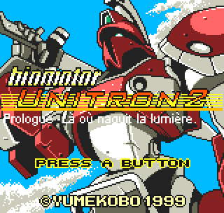
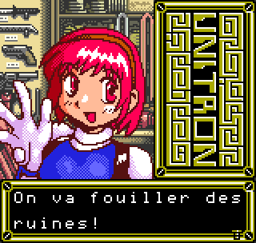

# Biomotor Unitron 2 (Kikou Seiki Unitron) — traduction française

**Kikou Seiki Unitron: Sono Tsuide. Hikari Umareru Chi Yori.** (*Biomotor Unitron 2*, Neo Geo Pocket
Color, Yumekobo, sorti au Japon seulement), entièrement en français : toutes les scènes et
dialogues, les personnages en ville et dans les donjons, les dix caractères de la partenaire, les
combats, les pièces, objets, techniques, ennemis et attaques, les menus, la boutique, l'aide, les
options, la saisie du nom et l'écran titre.

<p align="center">
  
  
</p>

- **Partie 1 (français)** : jouer en français — le patch et comment l'appliquer.
- **Part 2 (English)** : the translation kit — tools and guide to translate the game into another language.

---

# Partie 1 — Jouer en français

## 1.1 Ce qu'il vous faut

Le patch : `patch/Unitron_2_FR_v1.0.ips`.

**Votre propre** copie de la cartouche **japonaise**, non modifiée et sans en-tête. Aucune ROM
n'est fournie ici. Vérifiez-la :

| | ROM d'origine attendue |
|---|---|
| Nom (par exemple) | `Kikou Seiki Unitron - Sono Tsuide. Hikari Umareru Chi Yori. (Japan).ngc` |
| Taille | 2 097 152 octets |
| CRC32 | `84580D66` |
| MD5 | `9827fe3f592bd73ce1603e516c5e0532` |
| SHA-1 | `b732c22631b05895ed7eebabfc3a59e28b04b364` |

Avec une autre ROM (traduction anglaise de fans, déjà modifiée, autre dump), le patch donnera un jeu
cassé.

## 1.2 Méthode A — patch appliqué à la volée par l'émulateur

L'émulateur applique le patch en mémoire à chaque lancement : la ROM d'origine n'est **pas
modifiée**. Posez le fichier `.ips` à côté de la ROM, **sous le même nom**, puis lancez la ROM
japonaise normalement :

```
Kikou Seiki Unitron - Sono Tsuide. Hikari Umareru Chi Yori. (Japan).ngc
Kikou Seiki Unitron - Sono Tsuide. Hikari Umareru Chi Yori. (Japan).ips
```

Ce patch **agrandit** la ROM (2 Mio → 4 Mio). L'application à la volée n'a pas été testée pour
cette version : en cas de souci, utilisez la méthode B.

## 1.3 Méthode B — créer une ROM française (console, ou tout autre émulateur)

Fabriquez une fois pour toutes une ROM patchée :

- avec un outil IPS courant : **Rom Patcher JS** (dans le navigateur), **Flips** ou **Lunar IPS** ;
  choisissez la ROM japonaise, puis le `.ips`, et enregistrez le résultat ;
- ou avec l'outil fourni (Python 3) :

  ```
  python tools/ips.py apply "Kikou Seiki Unitron - Sono Tsuide. Hikari Umareru Chi Yori. (Japan).ngc" patch/Unitron_2_FR_v1.0.ips Unitron_2_FR.ngc
  ```

La ROM obtenue doit avoir ces empreintes, quel que soit l'outil :

| | ROM française obtenue |
|---|---|
| Taille | 4 194 304 octets |
| CRC32 | `1DEE345D` |
| SHA-1 | `3b59bdb8c664d650e4d542ab4ba8630a4235bd4d` |

## 1.4 Ce qui a été vérifié, ce qui ne l'a pas été (v1.0)

Vérifié à l'émulateur : écran titre, menu principal, écran des fichiers, saisie des noms (pilote,
partenaire, Elel) et écran de confirmation, combat d'introduction (commandes, choix d'arme,
informations d'arme, messages), scènes du prologue chez Thomas, premier donjon, options, les
17 pages de l'aide et la liste des pièces.

Tout le texte est contrôlé automatiquement (largeur et nombre de lignes de chaque boîte, place de
chaque nom) : la ROM n'est pas fabriquée s'il reste une erreur. Le mécanisme qui déplace le texte a
été validé en faisant passer **tout** le texte japonais d'origine par lui : le jeu est identique à
l'original, image par image.

Pas encore vu à l'écran : les conversations en ville (leur enchaînement de boîtes est contrôlé dans la
ROM, mais pas encore lu en jeu), les menus des villes et la plupart des scènes du milieu et de la fin
du jeu, la liaison câble. Un retour est bienvenu si un texte déborde ou se coupe. La ROM n'a pas encore
été essayée sur une vraie console.

## 1.5 Choix de traduction

- Traduit depuis le **japonais** (le jeu est entièrement en kana), puis **entièrement relu** contre
  l'original. On **adapte** plutôt qu'on ne traduit mot à mot : chaque réplique doit avoir du sens dite
  par ce personnage.
- Le héros porte le nom que vous lui donnez et peut être un garçon ou une fille : tout ce qui parle de
  lui reste **épicène**.
- La partenaire existe en **dix caractères** au choix ; chacun garde sa voix d'un bout à l'autre (le
  garçon bourru, la fille-chat et son « nya », le jeune homme qui vouvoie son père, la petite timide…).
- Noms en katakana d'origine anglaise gardés en anglais (pièces, attaques, techniques : *Storm Leo*,
  *Exploder*, *Angel Halo*…) ; le reste est traduit. **HP / EP / EXP** gardés (ils sont dessinés dans
  l'écran de combat).
- Les noms affichés dans la liste d'armes du combat tiennent en 10 lettres : quelques armes ont un nom
  court (*Shotgun*, *Sulfateuse*, *Faucheuse*…).
- Police : minuscules et accents ajoutés (é è ê ë à â ä î ï ô ö ù û ü ç œ, et les majuscules
  accentuées). La grille de saisie du nom a été refaite : minuscules, page « ABC » des majuscules, et
  accents.
- Écran titre redessiné en lettres latines (« biomotor UNITRON 2 »).

## 1.6 Crédits

- **Traduction française, police, écran titre, outils** : **Tixul**, sous **licence MIT** (fichier
  `LICENSE`) pour les outils et les fichiers de traduction.
- *Kikou Seiki Unitron* © 1999 Yumekobo. Ce projet de fans n'est ni affilié ni approuvé par les ayants
  droit. Il ne contient **ni ROM, ni BIOS, ni texte d'origine** : le patch ne contient que des octets
  modifiés, et le texte japonais n'est obtenu qu'en l'extrayant de sa propre ROM.

---

# Part 2 — Translation kit (English)

Everything needed to translate the game into **another Latin-alphabet language**. You edit text
files; the tools rebuild the ROM (text relocated into a second 2 MiB chip, longer and extra boxes,
longer item and enemy names, Latin font with accents, name-entry grid, wider windows) and refuse to
build while a rule is broken.

| Folder / file | Content |
|---|---|
| `lang/fr/` | the French translation (text files), its glossary and style guide — use it as your template |
| `tools/` | extract the text, check a translation, build the translated ROM and the IPS patch |
| `tools/asm/` | source of the small routine added to the game (assembled with AS, `cpu 96C141`) |
| `tools/gfx/` | the Latin title screen |
| `patch/` | the released French patch |
| `screenshots/` | the two screenshots shown at the top of this file |
| `FORMAT.md` | technical notes on the ROM: scripts, text codes, font, relocation, windows (in French) |

## 2.1 Requirements
- Python 3.9 or later, and **Pillow** (`pip install pillow`, used for the title screen).
- The original **Japanese ROM** (hashes in section 1.1). The build checks it and refuses any other file.

## 2.2 Steps
1. **Extract the Japanese text** from *your own* ROM (it is not distributed):
   ```
   python tools/extraire.py "Kikou Seiki Unitron - Sono Tsuide. Hikari Umareru Chi Yori. (Japan).ngc"
   ```
   This writes `out/catalogue.tsv`: one line per text, `address · type · instruction · Japanese`.
   Types: `SCRIPT` (event dialogue), `CHOIX` (choice in an event), `ACTEUR` (characters and objects in
   towns and dungeons), `FICHE` (names: parts, items, techniques, enemies, attacks, elements),
   `POINTE` (menus, system and battle messages, help), `SUITE` (a string read right after a `POINTE`),
   `BLOC` (strings rewritten in place inside a fixed-size block).
2. **Copy** `lang/fr` to `lang/<code>` (e.g. `lang/es`) and translate (rules below).
3. **Check, then build** the ROM and the patch, and test in an emulator:
   ```
   python tools/controle.py ROM_JP.ngc lang/<code>/*.txt
   python tools/build.py --rom ROM_JP.ngc --lang <code> --ips
   ```
   Output: `out/<code>.ngc` and `out/<code>.ips` (a patch for the **Japanese** ROM).
   ⚠️ Distribute the **.ips** only, never the ROM.

## 2.3 File formats and rules

Every `*.txt` file in `lang/<code>/` is read; `#` starts a comment line. One line per text:

| Line | Meaning |
|---|---|
| `@ADDRESS<TAB>text` | the text found at this (file, hex) address in `out/catalogue.tsv` |

A text with no line keeps its Japanese. In the text:
- `{n}` new line — in dialogue boxes the two lines are separated by `{n}{n}` (as in the original);
  `{box}` **new box** (`SCRIPT` and `ACTEUR` only: add as many boxes as you need); `{p}` clears the
  box (keep it where the original has it).
- Codes to keep (their place in the sentence is free): `{J}` pilot's name, `{P}` partner's name,
  `{FF07}` the Elel's name (6 letters each), `{FE00}`–`{FE0F}` a number, `{FE10}`–`{FE1F}` an inserted
  name (item, technique), `{FE20}` enemy name, `{FE21}`/`{FE22}` attack name (14 letters each);
  `{xx}` raw byte.

Limits, checked by `controle.py` (all errors are listed at once):
- Dialogue boxes: **18 columns × 2 lines**. Names (`FICHE`): **14 characters**. `BLOC`: the strings of a
  block share the original number of bytes (the build warns and keeps the original block otherwise).
- Short labels longer than the original only give a warning: check them on screen (fixed-width
  windows cut the text; some windows were widened, see `PATCHS_FENETRES` in `tools/build.py`).
  The weapon list in battle shows 10 characters, the name-confirmation screen 6.
- Characters: `a-z A-Z 0-9`, `é è ê ë à â ä î ï ô ö ù û ü ç œ É È Ê Ë À Â Ä Ç Ô Ö Î Ï Œ Ù Û Ü °`,
  `. , ; : ! ? - ' … ( ) « » % / + = < > # ~ ★ ♥`, `【 】` (shown as brackets). They are drawn on
  the free kana slots of the font: `FR_EXTRA` in `tools/table.py` (append only) and the glyphs in
  `tools/police.py`.

Language-specific parts live in the tools (edit them for your language): `tools/police.py` (glyphs),
`tools/grille.py` (name-entry grid), `tools/gfx/titre_fr.png` (title screen, 160×152),
`tools/build.py` (`PATCHS_FENETRES`: widened windows and moved cursors).

`python tools/build.py ROM_JP.ngc OUT.ngc --tout-en-saut` routes **all** the text through the
relocation mechanisms with its original Japanese: the game must play exactly as the original.

## 2.4 Credits and legal
- French translation, font, title screen and tools: **Tixul**, released under the **MIT License**
  (see `LICENSE`).
- *Kikou Seiki Unitron* © 1999 Yumekobo. This fan project is not affiliated with or endorsed by the
  rights holders. It contains **no ROM, no BIOS and no original game text**; the Japanese text is only
  obtained by extracting it from your own ROM.
